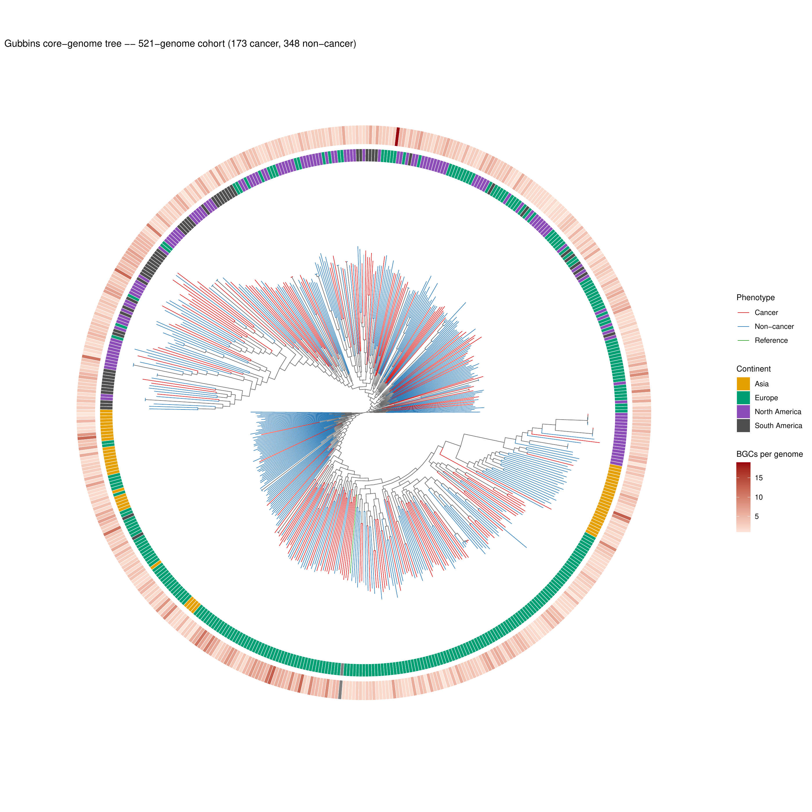
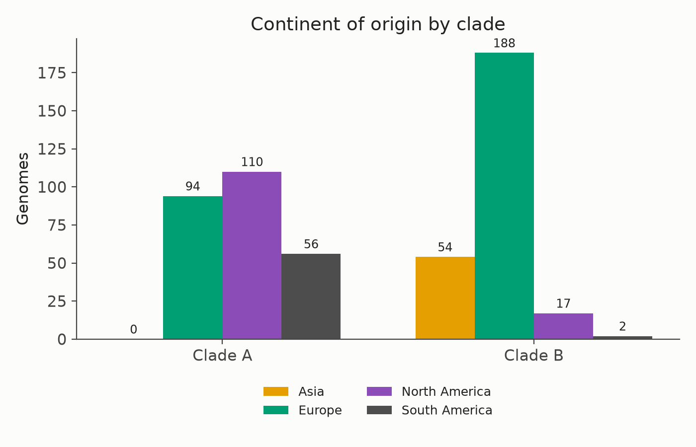
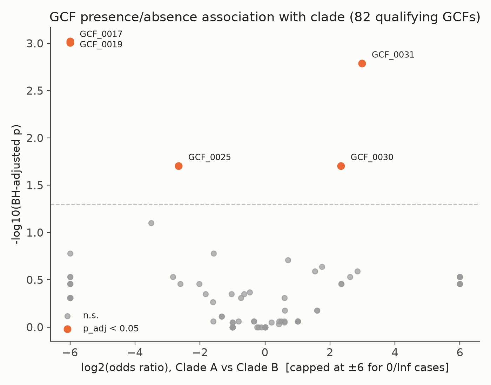
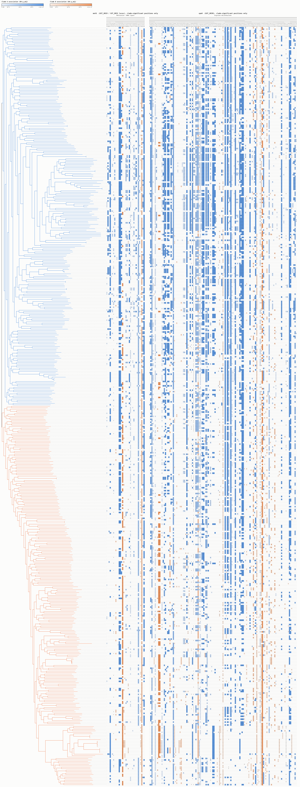
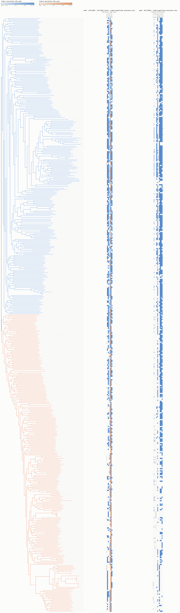
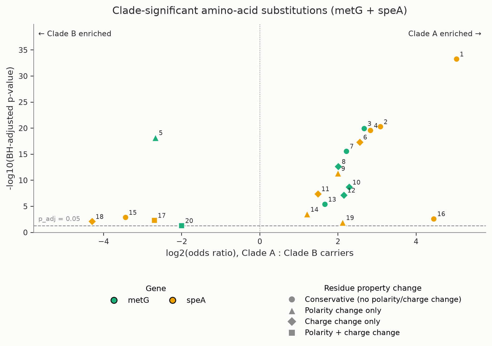

```{=html}
<style>
  .fig-shell { text-align: center; margin: 1.2em 0; }
  .fig-shell img {
    max-width: 100%;
    border: 1px solid #ddd;
    border-radius: 4px;
    cursor: zoom-in;
    transition: box-shadow 0.15s;
  }
  .fig-shell img:hover { box-shadow: 0 2px 10px rgba(0,0,0,0.15); }
  .fig-note { font-size: 0.92em; color: #555; margin-top: 0.4em; }
  .fig-note a { white-space: nowrap; }

  #lightbox-overlay {
    display: none; position: fixed; inset: 0; z-index: 9999;
    background: rgba(20,20,20,0.92);
    overflow: auto; text-align: center; cursor: zoom-out;
  }
  #lightbox-overlay.open { display: block; }
  #lightbox-overlay img { margin: 2vh auto; display: block; max-width: none; }
  #lightbox-hint {
    position: fixed; top: 12px; left: 50%; transform: translateX(-50%);
    color: #eee; font: 13px sans-serif; background: rgba(0,0,0,0.5);
    padding: 4px 12px; border-radius: 12px; z-index: 10000;
  }

  table#subTable { font-size: 0.88em; }
  table#subTable td, table#subTable th { white-space: nowrap; padding: 4px 8px; }
  .summary-table th, .summary-table td { padding: 5px 10px; vertical-align: top; }
</style>

<div id="lightbox-overlay" onclick="closeLightbox()">
  <div id="lightbox-hint">Click anywhere to close &middot; scroll/drag to pan &middot; full resolution</div>
  
</div>

<script>
  function openLightbox(src) {
    document.getElementById('lightbox-img').src = src;
    document.getElementById('lightbox-overlay').classList.add('open');
  }
  function closeLightbox() {
    document.getElementById('lightbox-overlay').classList.remove('open');
    document.getElementById('lightbox-img').src = '';
  }
  document.addEventListener('keydown', function(e) { if (e.key === 'Escape') closeLightbox(); });

  function openFullSize(linkEl) {
    var img = linkEl.closest('.fig-shell').querySelector('img');
    var src = img.src;
    if (src.indexOf('data:') === 0) {
      fetch(src).then(function (res) { return res.blob(); }).then(function (blob) {
        window.open(URL.createObjectURL(blob), '_blank');
      });
    } else {
      window.open(src, '_blank');
    }
  }
</script>
```

## Overview

Status report for the *H. pylori* BGC/GCF–cancer phylogenomics work: how the
tree was built and validated, what it found, and the deep-dive that followed.
This is a living document — new sections get added as the work progresses,
rather than a new report each time. The short BSB paper itself (mining, GCF
clustering, phenotype association on the published cohort) isn't retold here;
this starts where the phylogenomics side-project does.

## Building a trustworthy phylogenomic backbone

The paper's own cancer-association test used self-reported continent as a
crude stand-in for shared ancestry. Replacing that with a real tree meant
getting the input cohort and the tree-building approach right first.

**The cohort turned out to need deduplication.** QC surfaced 40 near-identical
genome pairs. Tracing NCBI BioSample metadata for all 80 accessions found
essentially none were independent samples — literal duplicate deposits,
same-patient pairs, even cross-project overlaps between studies drawing on the
same isolate collection. That made the deduplicated cohort the right *primary*
analysis, not a secondary check:

|  | Genomes | Cancer | Non-cancer |
|---|---|---|---|
| Original cohort | 554 | — | — |
| **Deduplicated cohort (used throughout)** | **521** | **173** | **348** |

Because this changes the independence assumption behind the paper's own
statistics, it was raised directly with the PC chair rather than decided
unilaterally — authorized for the camera-ready version on two conditions (no
change to conclusions, no exceeding the page limit). Both held: the
521-genome reanalysis reproduced every qualitative finding of the 554-genome
version.

**The reference-mapping shortcut was validated, not assumed.** Mapping every
genome to one reference genome is only valid if that's a fair stand-in for a
reference-free pangenome method. Panaroo (reference-free) was run on the same
50-genome pilot and compared against the mapping-based tree: the two
disagreed moderately on exact topology but agreed strongly on overall
relatedness (Pearson r = 0.982) — the right bar for what the tree is actually
used for (ancestry correction), so the shortcut was kept for the full run.

**The tree-builder was chosen on evidence, not assumption.** A speed test
across several Gubbins tree-building strategies on a staged 175-genome
alignment, benchmarked against the same r ≥ 0.98 bar, found `--tree-builder
hybrid` (FastTree, then RAxML for later iterations) gave the best balance:
5h17min versus a 22-hour full-accuracy reference, matching its recombination
fraction almost exactly, and tracking relatedness slightly better than
FastTree alone (r = 0.993 vs. 0.989 — FastTree was faster but called ~25% more
recombination). Hybrid mode is what the full 521-genome run used.

## The root split

The finished tree split at the root into two large, roughly equal clades
(Clade A, Clade B) rather than branching gradually.

::: {.fig-shell}
<a href="#" onclick="openLightbox(this.querySelector('img').src); return false;">

</a>
<div class="fig-note">
<a href="#" onclick="openFullSize(this); return false;">open full-size in a new tab</a>
</div>
:::

**The split tracks geography, not cancer.** Clade membership shows no
association with phenotype (Fisher p = 0.78; 88/172 vs. 85/176 — essentially
identical). Continent tells the real story: Clade A is Europe/North
America/South America with zero Asian genomes; Clade B is almost entirely
Europe/Asia with almost no American representation — consistent with known
*H. pylori* phylogeographic structure.

::: {.fig-shell}
<a href="#" onclick="openLightbox(this.querySelector('img').src); return false;">

</a>
<div class="fig-note">
<a href="#" onclick="openFullSize(this); return false;">open full-size in a new tab</a>
</div>
:::

**Five GCFs track the split; zero track phenotype.** Reusing the paper's own
Fisher's-exact/BH method, substituting clade for phenotype: 5 of 82 qualifying
GCFs are significant at p_adj < 0.05, against 0 of 85 for phenotype anywhere
in the paper.

::: {.fig-shell}
<a href="#" onclick="openLightbox(this.querySelector('img').src); return false;">

</a>
<div class="fig-note">
<a href="#" onclick="openFullSize(this); return false;">open full-size in a new tab</a>
</div>
:::

GCF_0017 and GCF_0019 are completely clade-B-exclusive (16–17 carriers, zero
in Clade A); a minimum-independent-clusters check (collapsing carriers that
are each other's closest relatives) confirmed these aren't a few close
relatives inflating the count — both are close to the maximum possible number
of independent clusters for their carrier count. GCF_0025, GCF_0030 and
GCF_0031 are strongly clade-enriched but not exclusive. Two of the five
(GCF_0017, GCF_0019) echo, by domain content, the same two themes the original
undergraduate pilot study flagged: lipogenesis and tRNA modification — the
thread this report's deep-dive follows.

## The five loci, in brief

Locating each GCF's actual genomic position (not just its deepBGC call)
identified the real gene(s) behind each, their predicted role, and — via a
literature check — whether that role has any independent cancer or
*H. pylori*-biology relevance:

::: {.summary-table}
| GCF | Gene(s) | Predicted role | Clade pattern | Literature context |
|---|---|---|---|---|
| GCF_0017 | ketoacyl-ACP synthase III | PKS/fatty-acid-synthase-like (echoes the pilot's lipogenesis finding) | B-exclusive | Structural analogy to colibactin, the *pks*+ *E. coli* genotoxin implicated in colorectal cancer — analogy only, no evidence of a shared mechanism |
| GCF_0019 / GCF_0031 | `metG` + ferrochelatase + `cmoB` (confirmed same locus) | tRNA-synthetase + tRNA-modification enzyme (echoes the pilot's tRNA-modification finding) | B-exclusive / A-enriched | tRNA-modification-driven translational reprogramming is an active cancer-biology theme; *H. pylori* separately carries the largest DNA-methyltransferase repertoire of any known pathogen |
| GCF_0025 | `hofH` | Outer-membrane protein (adhesin-like) | B-enriched | Same functional class (not the same gene) as BabA/SabA/OipA, established *H. pylori* gastric-cancer risk markers |
| GCF_0030 | `speA` | Arginine decarboxylase (polyamine pathway) | A-enriched | The host arginase/ODC/SMOX pathway is one of the best-established *H. pylori*-gastric-cancer mechanisms — though that literature is about the host's response, not this bacterial gene |

:::

None of this is evidence that these genes themselves affect cancer risk — the
literature links are thematic, not causal. GCF_0017 and GCF_0025 don't appear
in the alignment figures below: both turned out to be genuinely accessory
(absent from enough of the 521 genomes to fail snippy-core's core-alignment
threshold entirely), so there's no genome-wide nucleotide alignment to draw
for them. `metG` and `speA` are core (present in essentially every genome),
which is what the figures below are built from.

## Nucleotide variable sites {#sec-snp}

`metG` (shared GCF_0019/GCF_0031 locus) and `speA` (GCF_0030), restricted to
the positions where a specific nucleotide allele is significantly associated
with one clade. 165 columns total across both genes.

::: {.fig-shell}
<a href="#" onclick="openLightbox(this.querySelector('img').src); return false;">

</a>
<div class="fig-note">
Figure is 3,726 &times; 9,732 px (all 521 genomes) &mdash;
<a href="#" onclick="openFullSize(this); return false;">open full-size in a new tab</a>
</div>
:::

## Amino-acid variable sites {#sec-aa}

Same two genes, translated: columns are codon positions where the resulting
*amino acid* (not just the underlying nucleotide) is significantly
clade-associated. Far fewer columns than the nucleotide figure (19 vs. 165) —
most of that nucleotide-level signal is synonymous.

::: {.fig-shell}
<a href="#" onclick="openLightbox(this.querySelector('img').src); return false;">

</a>
<div class="fig-note">
Figure is 2,849 &times; 9,678 px (all 521 genomes) &mdash;
<a href="#" onclick="openFullSize(this); return false;">open full-size in a new tab</a>
</div>
:::

## Substitution volcano {#sec-volcano}

Every substitution behind @sec-aa, plotted as log2(odds ratio, Clade A : Clade
B carriers) against -log10(BH-adjusted p-value). Point color = gene, point
*shape* = how disruptive the substitution is physicochemically (circle =
conservative, up to square = both polarity and charge change). Labels are the
same `#` IDs as the table right below — click a column header there to sort,
or use the search box to jump to a gene or substitution.

::: {.fig-shell}
<a href="#" onclick="openLightbox(this.querySelector('img').src); return false;">

</a>
<div class="fig-note">
<a href="#" onclick="openFullSize(this); return false;">open full-size in a new tab</a>
</div>
:::

### All 20 substitutions



```{=html}
<link rel="stylesheet" href="https://cdn.datatables.net/1.13.8/css/jquery.dataTables.min.css">
<script src="https://code.jquery.com/jquery-3.7.1.min.js"></script>
<script src="https://cdn.datatables.net/1.13.8/js/jquery.dataTables.min.js"></script>
<script>
  $(document).ready(function () {
    $('#subTable').DataTable({
      order: [[13, 'asc']],
      pageLength: 20,
      lengthChange: false
    });
  });
</script>
```

## Where this comes from

- Backbone/root-split methodology and caveats: `analysis/phylogenetics/results/report5/report5.md`,
  `analysis/phylogenetics/results/root_split_comparison/report.md`
- GCF deep-dive methodology, literature citations, and caveats:
  `analysis/phylogenetics/results/gcf_roles_followup/report.md`
- Figure/table scripts: `analysis/phylogenetics/scripts/make_variable_sites_fig.py`,
  `make_variable_aa_fig.py`, `make_aa_substitution_table.py`, `make_aa_substitution_volcano.py`
- This page's own source: `docs/project_report/index.qmd` (+ `table_partial.html`,
  `figs/`) — regenerate the table with `make_visual_report_table.py`, then
  `quarto render index.qmd` from this folder.
